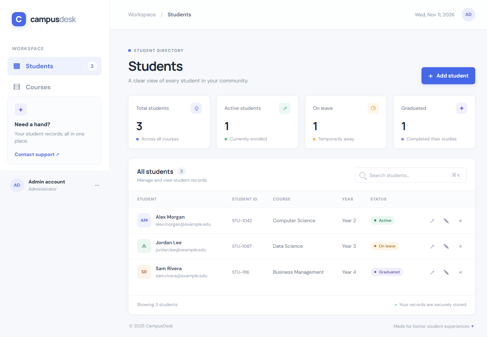
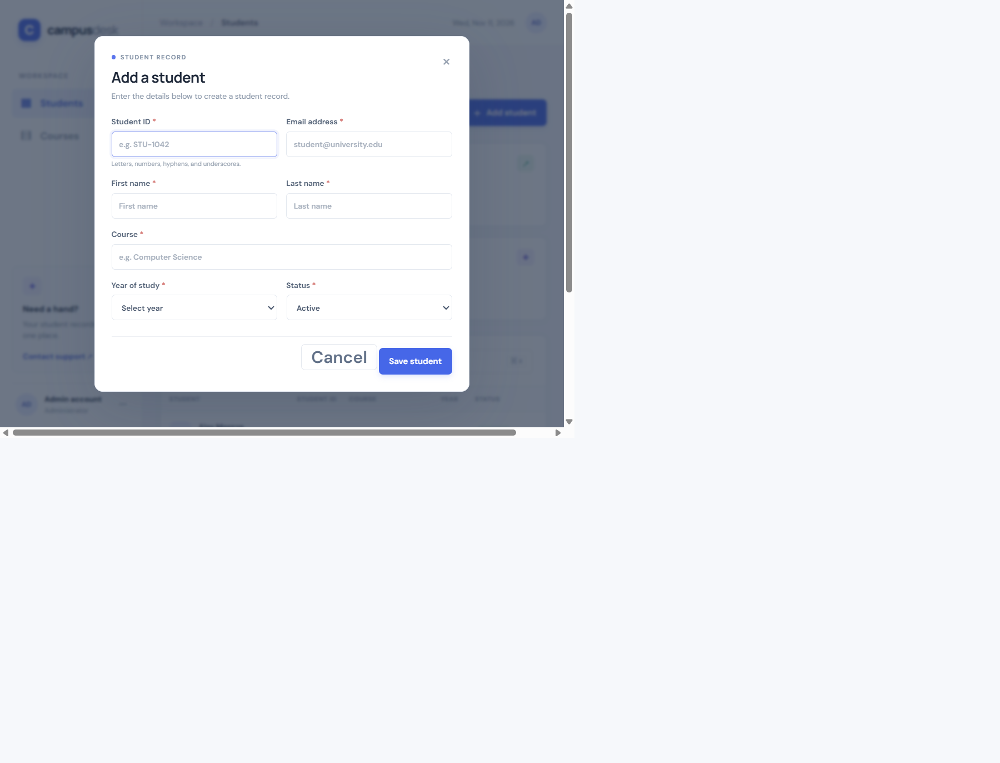

# CampusDesk Student Management

A responsive student directory with a Python standard-library HTTP API and a persistent SQLite database.

Copyright (c) 2026 Thato Mosia. All rights reserved. No license to reuse or redistribute this project is granted.

> **Local demo only:** The API has no authentication. Do not expose this server to the internet or use it with real student records.

## Run locally

Requires Python 3.9 or newer. From this folder, run:

```powershell
python server.py
```

Open [http://127.0.0.1:8080](http://127.0.0.1:8080). If needed, set the `PORT` environment variable before starting the server. Student records are stored in `students.db`, created automatically on first startup.

## API

- `GET /api/students` — list students; optionally search with `?q=...`
- `POST /api/students` — create a student
- `GET /api/students/{id}` — retrieve one student
- `PUT /api/students/{id}` — update a student
- `DELETE /api/students/{id}` — delete a student

Student records require a unique student ID and email, first and last names, course, year (1–8), and status (`Active`, `On leave`, or `Graduated`).

## Run tests

```powershell
python -m unittest -v test_api
```

## Screenshots

### Student directory



### Add student form


